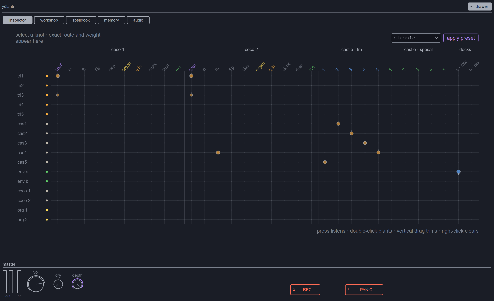
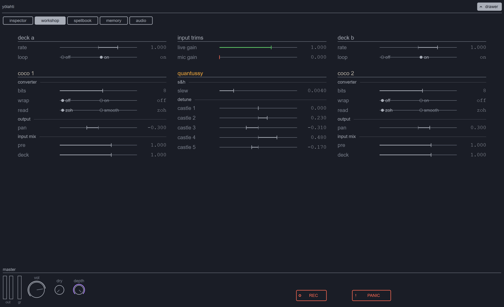

# Yönpuoli

[](https://github.com/VaahtoluotoTuomas/yonpuoli/actions/workflows/ci.yml)

**A nocturnal feedback instrument for SuperCollider.**

*Memory circulates until it becomes weather.*

[Download Yönpuoli 1.0.0](https://github.com/VaahtoluotoTuomas/yonpuoli/releases/tag/yonpuoli-1.0.0)


Yönpuoli is a personal experimental instrument built around two coarse,
clocked loop memories. Sound passes through an intentionally low-resolution
converter, a five-oscillator chaotic network, and a signed patch matrix. The
result sits somewhere between a looper, a feedback processor, and a small
electronic ecosystem.

> **Lineage, not emulation.** Yönpuoli grew from a software study of Peter
> Blasser's Ciat-Lonbarde Cocoquantus. It interprets its dual clocked memories,
> five-castle Quantussy network, and part of its vocabulary, but it is not a
> circuit model, faithful emulation, official port, or affiliated
> Ciat-Lonbarde product.

## Start on Windows

Requirements:

- Windows 10 or 11;
- [SuperCollider](https://supercollider.github.io/) 3.13 or newer;
- headphones, laptop speakers, or an audio interface.

No Quarks or third-party plugins are required.

1. Download and unzip the repository, or clone it with Git.
2. Double-click [`YONPUOLI.bat`](YONPUOLI.bat).
3. Keep the small diagnostic console open while playing. Closing the Yönpuoli
   window also stops its private audio server and closes the launcher.
4. Put a `.wav`, `.aiff`, or `.flac` file in `samples/`, or choose one from the
   Night window.

The launcher finds an installed SuperCollider, prepares missing local folders,
and starts Yönpuoli without requiring the SuperCollider IDE. It never overwrites
an existing local configuration.

> **New to Yönpuoli?** Open the
> **[Night field guide / Quick Reference](docs/QUICK_REFERENCE.md)**. It maps the
> Night landmarks, gestures, Drawer pages, and shortcuts, beginning with the
> sample-to-loop workflow at the centre of the instrument.

## Make the first loop

1. Tap either bird at the top of Night and choose an audio file.
2. Raise Master **dry** to preview it.
3. Tap the small heart in the matching Coco spiral so that it opens, then let
   the sample write into memory.
4. Tap the heart again to seal Hold, lower **dry**, and play the captured loop
   with the spiral and the Input, Feedback, and Level gestures.

Start at a low monitoring level. `Space` is always PANIC.

This sample-to-memory gesture is Yönpuoli's centre. Organ, Quantussy, dust, and
self-running presets are alternate voices and layers rather than prerequisites
for making the first sound.

## The instrument

- **Two Coco memories** recirculate audio through clock-rate repitching,
  feedback above unity, hold, flip, skip, gate/duck articulation, digital dust,
  and square-stack organ voices.
- **Five castles** form a Quantussy-inspired modulation network that moves from
  slow stepped wandering to audio-rate chaos.
- **The 16×32 matrix** patches sixteen sources into thirty-two destinations with
  signed, continuously variable cables.
- **Night** turns the topology into a landscape of birds, shells, roots,
  castles, shores, bridges, and weather gestures.
- **The Drawer** provides exact routing, secondary parameters, patch history,
  snapshots, morphing, and audio-device setup.
- File decks, live inputs, recording, optional stems, and optional 16n control
  can be used independently.

<details>
<summary><strong>Open the precision Drawer</strong></summary>

**Inspector — exact matrix values and factory presets**



**Workshop — secondary parameters and exact values**



</details>

## Audio devices

Machine-specific settings live in the ignored `config.scd` and
`config.audio.scd` files. If headphones or an interface are connected while
Yönpuoli is already open:

1. open **Drawer → audio**;
2. choose **find connected devices** and confirm the scan/restart;
3. wait for **device scan complete · choose route above**;
4. choose the new output, then use the highlighted restart action.

On Windows, separate inputs and outputs must use the same host API. For example,
a laptop microphone and wired headphones can be paired as two `Windows WASAPI`
devices in **split devices** mode; an ASIO/WASAPI pair cannot form one stream.

If a saved device is absent, Yönpuoli can start on a temporary working route
without forgetting the preference. **retry preferred audio** searches for it
again. **keep current audio → keep & restart** deliberately saves the temporary
route instead. Startup still opens on Night rather than redirecting the player
to a setup page.

## Presets and snapshots

Six authored presets provide different entrances:

- `classic` animates external material like worn tape;
- `selfNoise` grows irregular converter weather without an input;
- `quantumDrone` catches the Quantussy ring in the two memories;
- `organMode` opens the clearest directly playable pitched voice;
- `crossCurrent` makes held memories exchange phrases through SlotX;
- `dustGarden` contrasts slow mist with brittle converter chips.

`empty` is a clearing utility and `mayhem` a dense deterministic stress field,
not promoted artistic starting points.

Yönpuoli also ships five snapshots. `example` is intentionally sparse;
`undertow`, `dust_bloom`, `glass_tide`, and `organ_lanterns` are complete scenes
and useful morph endpoints. Snapshots store instrument state, not Coco buffer
audio. Personal snapshots remain local. See
[`snapshots/README.md`](snapshots/README.md) for the exact bank.

## Live coding

The GUI is enough to play the whole instrument, but the same state is available
from SuperCollider:

```supercollider
CQ.boot;
CQ.deckA.load("my_recording.wav");
CQ.set(\masterDry, 0.3);
CQ.hold(1, 0);                     // write the deck into Coco 1
CQ.set(\coco1Fb, 1.0);            // echo → loop → bounded crunch
CQ.set(\coco1Speed, 12000);        // clock-rate repitch
CQ.patchPreset(\classic);
CQ.shake;
CQ.rec; CQ.recStop;
CQ.panic;
```

More performance fragments live in [`live.scd`](live.scd).

For IDE development, add `classes/` to SuperCollider's language include paths,
copy `config.example.scd` to the ignored `config.scd`, recompile the class
library, and evaluate `boot.scd`. Unit development also adds `tests/classes/`.

## Architecture and safety

GUI, code, MIDI, snapshots, and generative gestures all write through the same
validated `CQState` / `CQMatrix` funnels. The audio graph stays static while
playing, apart from explicit transactions such as deck swaps and recording.

Every hardware output passes through a non-bypassable chain:

```text
LeakDC → bounded tanh headroom → Limiter(0.89) → bad-value squelch
```

Coco feedback is clipped or wrapped before re-quantization inside the loop, so
feedback above unity remains a sound-design region instead of an unbounded
output path. Microphone gain defaults to zero, boot fails toward silence, and
PANIC remains available from every playing state.

The main headless checks use the repository's guarded runner:

```powershell
powershell -NoProfile -ExecutionPolicy Bypass -File tests/run_sclang_gate.ps1 tests/compile_check.scd
powershell -NoProfile -ExecutionPolicy Bypass -File tests/run_sclang_gate.ps1 tests/run_all.scd
powershell -NoProfile -ExecutionPolicy Bypass -File tests/run_sclang_gate.ps1 tests/nrt_safety.scd
```

See [`tests/manual_checklist.md`](tests/manual_checklist.md) for the repeatable
hands-on smoke test. Automated checks do not replace listening, visual, or
hardware evaluation.

## Project notes

### Play and reference

- **[Night field guide / Quick Reference](docs/QUICK_REFERENCE.md)** — the
  sample-to-loop path and a map of the complete playing surface.
- [`docs/16N_MAP.md`](docs/16N_MAP.md) — optional 16n fader layout.
- [`docs/RELEASE_NOTES_1.0.0.md`](docs/RELEASE_NOTES_1.0.0.md) — release notes.

### Design and development

- [`docs/CASE_STUDY.md`](docs/CASE_STUDY.md) — the project's design story and
  AI-assisted working process.
- [`ARCHITECTURE.md`](ARCHITECTURE.md) — code and signal ownership.
- [`SPEC.md`](SPEC.md) — exact behavior, parameters, DSP, and safety.
- [`GUI_SPEC.md`](GUI_SPEC.md) — the full Night and Drawer interaction grammar.
- [`SOURCES.md`](SOURCES.md) — lineage, sources, and interpretations.
- [`CHANGELOG.md`](CHANGELOG.md) — release history.
- [`CONTRIBUTING.md`](CONTRIBUTING.md) — notes for contributors.

## Making Yönpuoli

Yönpuoli is a personal project conceived and directed by **Tuomas Vaahtoluoto**.
Its musical concept, visual language, requirements, and final release decisions
grew through hands-on playing and listening. Claude Code and OpenAI Codex were
used extensively as coding agents for implementation, tests, documentation, and
technical investigation. The project does not hide that collaboration or claim
to have been typed by one person alone. A more detailed and candid account is in
the [`case study`](docs/CASE_STUDY.md).

## Lineage and acknowledgements

Yönpuoli began as a study of Peter Blasser's Ciat-Lonbarde Cocoquantus,
especially its pair of clocked 8-bit memories and five-oscillator Quantussy
network. Its Night interface, signed routing matrix, safety system, file decks,
snapshots, and weather gestures take the instrument in an independent direction.

This project is not affiliated with or endorsed by Peter Blasser or
Ciat-Lonbarde. Sources, interpretations, and deliberate deviations are listed in
[`SOURCES.md`](SOURCES.md). The inherited terms Coco, Quantussy, castle, Spesal,
SP.AF, flip, skip, and verso/inverso remain as an honest map of that lineage, not
as a fidelity claim. The lowercase term `dolby` describes the inherited
gate/duck vocabulary; it does not identify or implement Dolby Laboratories
technology.

## Known limits

- Windows is the only currently release-tested platform.
- Device hot-plug uses an explicit confirmed Audio-page restart rather than
  interrupting a performance automatically.
- Snapshots do not store the audio circulating in Coco memory.
- Optional 16n and multichannel paths are not required for ordinary stereo GUI
  use.
- Audio excerpts and a performance video will be added after 1.0.

## License

Yönpuoli is licensed under the
[GNU General Public License v3.0 or later](LICENSE).
