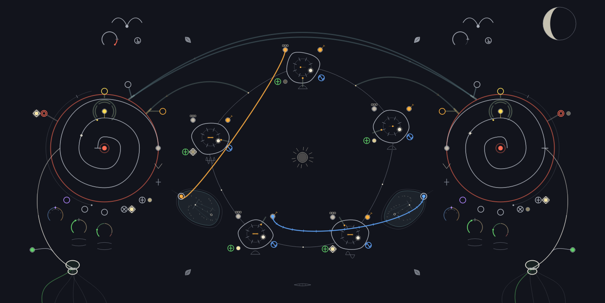

# Yönpuoli Night field guide

This quick reference maps the complete Night playing surface. Yönpuoli is meant
to be learned by touching it, but it should not make the first sound a puzzle.
Start at a low monitoring level. The blank instrument is quiet by design, and
`Space` is always PANIC.

## Sound in 60 seconds

### Primary path: turn a sample into a loop

1. Tap either bird at the top of Night and choose an audio file. Dropping a
   `.wav`, `.aiff`, or `.flac` file on the bird works too.
2. Raise **dry** in the Master strip to preview the deck directly.
3. Tap the small heart at the centre of the matching Coco spiral. Red/sealed is
   hold; open is writing. Let the sample pass into the memory.
4. Tap the heart again to seal the captured loop, then lower **dry** if you want
   to hear only the Coco.
5. Wind the spiral for repitching. Use the Input and Feedback crescents below it
   to shape how material enters and circulates. Feedback around unity loops;
   above unity blooms into bounded converter crunch.

This sample-to-memory act is the instrument's centre: external sound enters the
coarse converter, becomes held Coco memory, and is then played as a loop.

### Alternate voices: start without a sample

1. Open **drawer → inspector**.
2. Choose `organMode` and click **apply preset**.
3. Close the Drawer to return to Night.
4. On either Coco shell, drag vertically on the yellow Organ calyx to change its
   voice level. Drag along the spiral groove to change pitch and memory speed.
5. Try `quantumDrone`, `selfNoise`, or `dustGarden` when you want a different
   self-running layer.

These presets are useful alternate entrances, but they are secondary to learning
how a bird is written into a Coco and sealed into a playable loop.

## Read the Night

Hover a control, socket or cable to see its name and a short explanation in the
lower-left corner. This works while playing, with **info** off. Empty background
clears the text. Master meters, **vol**, **dry** and **depth** are at the bottom
right, after REC and PANIC.

Turn on **info** beside **drawer**, then click a component to read about it.
The lower-left area now holds a short mode instruction instead of individual
hover notes; it also points to the guides at top left. The learning guide changes that
instruction to guided playing. Leaving info restores ordinary hover help.
Each Coco, bird and root has its own card; the five castles share one. Eye,
moon, Tide and Master have their own topics. Controls and ports within a
component open the same card. Hover reveals the group without opening a note.

Cards sit beside their subject, keeping its controls and ports clear.
Hover a numbered picture mark or text row to
locate that part on the instrument. Coco fits its controls and connections on one
illustrated page. Castles have a shared-ring overview and a single-castle anatomy
page. Click another component to switch directly. **close** or empty
background closes only the card; **Esc** or **info** restores normal playing.
The info button breathes while enabled. PANIC and performance keys stay live.

The upper-left buttons are **basics & first loop**, **organ & advanced**, then **shortcuts**:

- **basics & first loop**: 23 illustrated pages combining introductions and
  hands-on steps. Meet the sources and Coco before recording; meet castles and
  ports before making and editing cables. Then capture a second sample, explore
  Input and Feedback separately, add dust, connect the Cocos, gate recording and
  try moon-generated patches. The button starts at page one with playing enabled.
  Read each introduction, then follow its exercise and choose **next**. Hover
  pictures to brighten their parts; practical steps also show action brackets.
  A cable click opens the port lesson in reading mode. Paging preserves inspection;
  use the guide button to start playing through it. Opening Shortcuts or closing
  the guide returns to inspection. Page one's **fresh session → reset now** starts again
  from defaults, replacing unsaved loop/patch/deck state; audio setup and saved
  files stay intact.
- **organ & advanced**: 27 pages build a new patch from scratch: Organ pulse and
  melody, roots and envelope control, dynamics/punch/skip, castle audio and Q,
  Organ-to-FM, the cross-feed bridge, then seed memories, blending, breeding and
  weather. The final pages introduce Drawer and saving. Its first page offers
  the same two-click fresh session and returns to this guide after resetting.
  Both guides are playable; reading and paging alone never change the sound.
- **shortcuts**: two pages of existing performance and patch/navigation keys.
  `1/2` toggle Coco write/hold; `R` records the stereo output to a file.

Multipage cards use **back / next / close** and left/right arrow keys; unavailable
directions stay grey. Cards stay above Master. Opening Drawer turns info off.

| Landmark | What the hand does |
|---|---|
| **Birds, top left and right** | Tap to choose a file; drop a file; wheel for previous/next. Pull a bird in any direction and release for a random file; it springs back with a small wiggle. Drag the wing crescent vertically for deck level. |
| **Coco spiral shells, left and right** | Drag along the groove for memory speed/pitch. Tap the heart to switch between writing and hold; hold the right mouse button on it for momentary punch-in. |
| **Shell tides and shore** | Drag the three lower crescents vertically for SP.AF, Input, and Feedback. Drag the outer shoreline for Coco level and the yellow calyx for Organ level. |
| **Central ring eye** | Drag vertically for global Quantussy pitch and horizontally for chaos. |
| **Five castles** | Tap a castle to step its Spesal state. Pull radially inward/outward to open/close its audio send. Tap its small lower ripple to cycle slow, medium, and audio-rate ranges. |
| **Two-lane bridge** | Drag either valve vertically to send the opposite Coco into this one. The two directions are independent. |
| **Dust veils below the inner shores** | Drag up/down for amount; left/right blends steady hiss into sparse chip crackles. Open the heart to hear changes written into memory. Both sides use the same screen axes. |
| **Bone moon, top right** | Tap to sow a musical shake. Drag horizontally first to choose a sparse/dark or fuller ecology. |
| **Roots, bottom left and right** | Live-input sources and envelope followers; their jacks can be patched like every other source. |

Hover is part of the vocabulary: the exact body or gesture that will answer the
next press brightens before you commit.

## Bananas and the matrix

| Gesture | Result |
|---|---|
| Drag a source jack to a socket | Plant a positive cable. Start with the right button for negative polarity. |
| Wheel while carrying a cable | Choose its strength before landing. `Z` / `X` is the touchpad-friendly equivalent. |
| Drag an existing plug or cable | Move it to another socket; release in open water to rip it out. |
| Wheel over a planted cable | Adjust its strength. Hold `Ctrl` for a fine step. |
| `Alt` + click a cable | Flip its polarity. |
| Right-click a cable or socket | Rip it out immediately. |
| Right-drag a loop in open water | Harvest every cable caught by the lasso. |
| Double-click a body, jack, or socket | Solo-light its connected routes without changing sound. `Esc` clears the light. |
| `Ctrl+Z` | Undo the last committed matrix operation. |

For an exact value or a dense patch, use **Drawer → inspector**. Pressing a cell
auditions it until release, double-click plants it, vertical drag edits it, and
right-click clears it.

## Drawer at a glance

| Page | Use it when you need… |
|---|---|
| **inspector** | the exact 16×32 matrix, an exact route value, or a factory preset |
| **workshop** | converter, source, pan, input-mix, and Quantussy setup values not duplicated on Night |
| **spellbook** | a readable history of committed patch operations or copyable SuperCollider code |
| **memory** | saved snapshots, A/B selection, and timed morphing |
| **audio** | device selection, connected-device discovery, route status, or a confirmed audio restart |

Presets are authored recipes. Snapshots are exact whole-instrument memories.
Your own snapshots stay local; factory snapshots are useful starting scenes and
morph endpoints.

## Master and keyboard

- Keep **vol** modest while learning feedback. **dry** monitors decks and live
  sources without passing through the Cocos.
- **REC** records the stereo output. **PANIC** mutes every owned output path.
- `1` / `2`: hold Coco 1 / 2
- `Q` / `W`: flip Coco 1 / 2
- `A` / `S`: skip Coco 1 / 2
- `3` … `7`: step castles 1 … 5
- `P`: shake
- `R`: record
- `Space`: PANIC
- `Ctrl+Z` / `Ctrl+X`: undo / redo a GUI patch edit or moon sow; text fields keep
  normal undo / cut. These keys cannot restore overwritten loop audio.

The flip input turns playback around once on each rising trigger. The direction
stays when the signal falls; the next rise turns it again. The chevron and Q/W
also turn the current direction around, regardless of previous triggers.

## If there is no sound

1. Check that PANIC is not active and that Master **vol** is audible.
2. For a deck preview, confirm its filename is shown and raise Master **dry**.
3. For a captured loop, open the matching heart long enough to write material,
   then seal it; check the Coco shoreline level and its Input crescent.
4. For immediate self-generated sound, apply `organMode` in Inspector.
5. For an audio-route problem, open **Drawer → audio**. If you connected a new
   device, use **find connected devices**, confirm the scan/restart, select the
   route, then use the highlighted restart action. If Night says
   `TEMPORARY AUDIO`, use **retry preferred audio** to keep waiting for the saved device,
   or **keep current audio → keep & restart** to make the working route persist.

Exact parameter behavior lives in [`../SPEC.md`](../SPEC.md), and the complete
interaction grammar in [`../GUI_SPEC.md`](../GUI_SPEC.md).
